  

  <a href="https://github.com/JesusJuarezRamirez123/Portafolio"><kbd>↗ Ver portafolio</kbd></a>
  &nbsp; · &nbsp;
  <a href="#tecnologías">Tecnologías</a>
  &nbsp; · &nbsp;
  <a href="#proyecto-actual">Proyecto actual</a>

## Sobre mí

Estudio Ingeniería en Tecnologías de la Información e Innovación Digital. Me interesa el desarrollo backend y cómo combinar aplicaciones, bases de datos e IA para resolver problemas concretos.

## Tecnologías

| Área | Herramientas |
| :--- | :--- |
| **Backend y software** | `Python` · `FastAPI` · `Java` · `PHP` |
| **Infraestructura y datos** | `Linux` · `Docker` · `Git` · `MySQL` · `SQLite` |
| **IA generativa** | `RAG` · `CrewAI` |

## Proyecto actual

> **Disponibilidad de medicamentos**  
> Proyecto académico para consultar la disponibilidad de medicamentos y facilitar su búsqueda.
